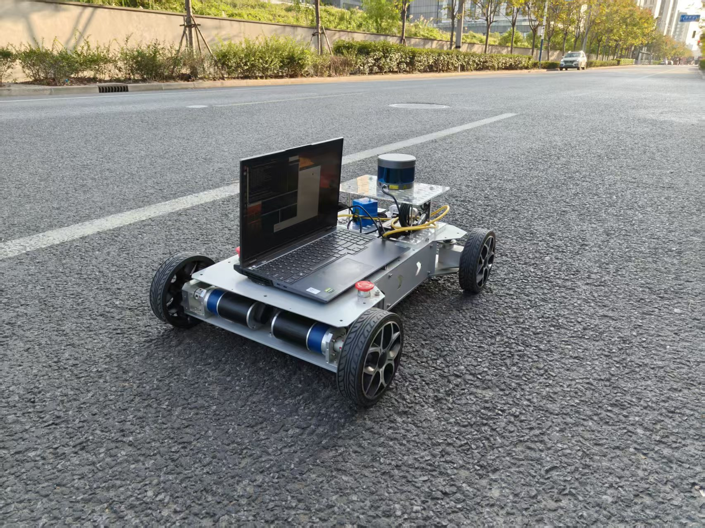

# 机器人项目、实习与论文材料

Robotics · Industry-Sponsored Projects · Internships · Papers

本仓库按**横向项目、实习、论文**三个方面整理机器人相关照片与演示视频。

## 材料导航

| 分类 | 内容 | 入口 |
| --- | --- | --- |
| 横向项目 | 番茄采摘机器人项目照片 | [查看横向项目](01-横向项目/) |
| 实习 | 龙创机器人实习照片 | [查看实习材料](02-实习/) |
| 论文 | 实验设备照片、定位导航演示视频 | [查看论文材料](03-论文/) |

## 一、横向项目

### 番茄采摘机器人

温室场景下的番茄采摘机器人与项目团队合影。


[查看原图](01-横向项目/负担番茄采摘机器人.jpg)

## 二、实习

### 龙创机器人实习

实习期间的机器人现场照片。


[查看原图](02-实习/龙创机器人实习.jpg)

## 三、论文

### 实验设备

论文相关的移动机器人实验平台照片。



### 定位导航演示

[查看或下载定位导航演示视频（MP4）](03-论文/论文定位导航.mp4)

## 目录结构

```text
.
├── README.md
├── 01-横向项目/
│   ├── README.md
│   └── 负担番茄采摘机器人.jpg
├── 02-实习/
│   ├── README.md
│   └── 龙创机器人实习.jpg
└── 03-论文/
    ├── README.md
    ├── 论文设备.jpg
    └── 论文定位导航.mp4
```

材料保留原始文件名。论文目录目前收录实验照片与演示视频。
